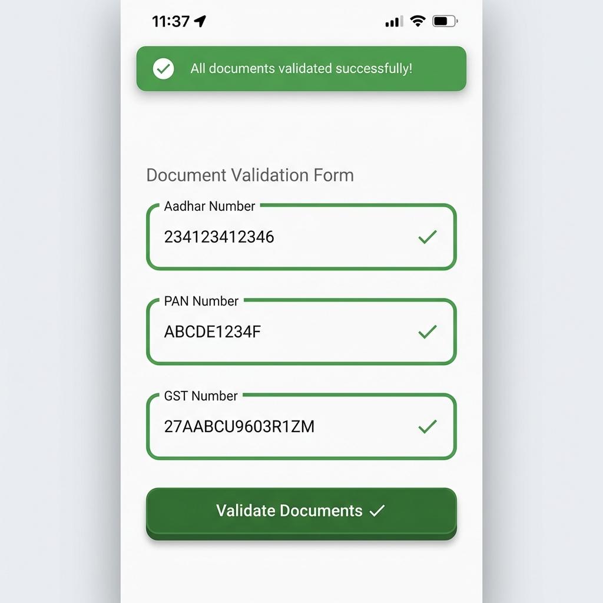

# govt_documents_validator

[](https://pub.dev/packages/govt_documents_validator)
[](https://opensource.org/licenses/MIT)
[](https://flutter.dev)
[](https://dart.dev)

A comprehensive Flutter package for validating Indian Government Documents including **Aadhar**, **PAN**, and **GSTIN** with checksum verification, masking, formatting, and batch validation utilities.

##  Features

-  **Aadhar Validation** - Verhoeff algorithm checksum verification
-  **PAN Validation** - Format validation with case-insensitive support
-  **GST Validation** - Luhn mod 36 algorithm with state code verification
-  **Document Masking** - Securely mask sensitive document numbers
-  **Document Formatting** - Format documents with proper separators
-  **Batch Validation** - Validate multiple documents at once
-  **Type Detection** - Auto-detect document type from input
-  **String Extensions** - Convenient validation methods on String
-  **Detailed Errors** - Get error codes and messages for failed validations
-  **Null-Safe** - Full null-safety support

##  Supported Documents

| Document | Length | Format | Algorithm |
|----------|--------|--------|-----------|
| **Aadhar** | 12 digits | `1234-5678-9012` | Verhoeff |
| **PAN** | 10 chars | `ABCDE1234F` | Regex Pattern |
| **GSTIN** | 15 chars | `27-AABCU9603R-1Z-M` | Luhn mod 36 |

##  Demo

### App Interface


### Successful Validation


The example app demonstrates:
-  Real-time validation for Aadhar, PAN, and GST numbers
-  Clear success/error feedback
-  Modern Material Design UI
-  All package features showcased

##  Installation

Add this to your package's `pubspec.yaml` file:

```yaml
dependencies:
  govt_documents_validator: ^1.0.0
```

Then run:

```bash
flutter pub get
```

##  Usage

### Basic Validation

```dart
import 'package:govt_documents_validator/govt_documents_validator.dart';

// Aadhar validation
AadharValidator aadharValidator = AadharValidator();
bool isValidAadhar = aadharValidator.validate('234123412346');

// PAN validation
PANValidator panValidator = PANValidator();
bool isValidPAN = panValidator.validate('ABCDE1234F');

// GST validation
GSTValidator gstValidator = GSTValidator();
bool isValidGST = gstValidator.validate('27AABCU9603R1ZM');
```

### String Extensions (Recommended)

```dart
import 'package:govt_documents_validator/govt_documents_validator.dart';

// Direct validation
bool isValid = '234123412346'.isValidAadhar();
bool isValid = 'ABCDE1234F'.isValidPAN();
bool isValid = '27AABCU9603R1ZM'.isValidGSTIN();

// Auto-detect and validate
bool isValid = '234123412346'.isValidDocument();

// Get document type
DocumentType type = '234123412346'.documentType; // DocumentType.aadhar
```

### Document Masking

```dart
// Mask sensitive data for display
String masked = '234123412346'.maskDocument(); // "XXXX-XXXX-9012"
String masked = 'ABCDE1234F'.maskDocument();   // "XXXXXX234F"
String masked = '27AABCU9603R1ZM'.maskDocument(); // "27XXXXXXXXXR1ZM"

// Or use the utility class
String masked = DocumentMasker.maskAadhar('234123412346');
```

### Document Formatting

```dart
// Format with proper separators
String formatted = '234123412346'.formatDocument(); // "1234-5678-9012"
String formatted = 'abcde1234f'.formatDocument();   // "ABCDE1234F"

// Clean formatted input
String clean = '1234-5678-9012'.cleanDocument(); // "123456789012"
```

### Batch Validation

```dart
final batchValidator = BatchValidator();

// Validate multiple documents
final results = batchValidator.validateAll({
  'customer_aadhar': '234123412346',
  'customer_pan': 'ABCDE1234F',
  'company_gst': '27AABCU9603R1ZM',
});

// Results: Map<String, bool>
results.forEach((key, isValid) {
  print('$key: ${isValid ? "Valid" : "Invalid"}');
});
```

### Detailed Validation

```dart
final batchValidator = BatchValidator();

// Get detailed results with error codes
final detailedResults = batchValidator.validateAllDetailed({
  'aadhar': '123456789013', // Invalid
});

ValidationResult result = detailedResults['aadhar']!;
if (!result.isValid) {
  print('Error: ${result.errorMessage}');
  print('Code: ${result.errorCode}');
}
```

### Type Detection

```dart
// Auto-detect document type
DocumentType type = BatchValidator.detectType('234123412346');
// Returns: DocumentType.aadhar

// Or use extension
DocumentType type = '234123412346'.documentType;
```

##  Use Cases

### Form Validation

```dart
String? validateAadharInput(String? value) {
  if (value == null || value.isEmpty) {
    return 'Please enter Aadhar number';
  }
  
  if (!value.isValidAadhar()) {
    return 'Invalid Aadhar number';
  }
  
  return null;
}
```

### Secure Display

```dart
Widget buildDocumentCard(String aadharNumber) {
  return Card(
    child: ListTile(
      title: Text('Aadhar Number'),
      subtitle: Text(aadharNumber.maskDocument()),
    ),
  );
}
```

### Multi-Document Validation

```dart
Future<bool> validateCustomerDocuments(Map<String, String> documents) async {
  final validator = BatchValidator();
  final results = validator.validateAll(documents);
  
  return results.values.every((isValid) => isValid);
}
```

##  API Reference

### Validators

- `AadharValidator().validate(String)` - Validate Aadhar number
- `PANValidator().validate(String)` - Validate PAN number
- `GSTValidator().validate(String)` - Validate GSTIN

### String Extensions

- `.isValidAadhar()` - Check if string is valid Aadhar
- `.isValidPAN()` - Check if string is valid PAN
- `.isValidGSTIN()` - Check if string is valid GSTIN
- `.isValidDocument()` - Auto-detect and validate
- `.documentType` - Get document type
- `.maskDocument()` - Mask the document
- `.formatDocument()` - Format the document
- `.cleanDocument()` - Remove formatting

### Utilities

- `DocumentMasker.maskAadhar(String)` - Mask Aadhar number
- `DocumentMasker.maskPAN(String)` - Mask PAN number
- `DocumentMasker.maskGSTIN(String)` - Mask GSTIN
- `DocumentFormatter.formatAadhar(String)` - Format Aadhar
- `DocumentFormatter.formatPAN(String)` - Format PAN
- `DocumentFormatter.formatGSTIN(String)` - Format GSTIN
- `BatchValidator().validateAll(Map)` - Batch validation
- `BatchValidator.detectType(String)` - Detect document type

### Models

- `DocumentType` - Enum for document types (aadhar, pan, gstin, unknown)
- `ValidationResult` - Detailed validation result with error codes
- `ValidationErrorCodes` - Standard error codes

##  Error Codes

- `EMPTY_INPUT` - Input is empty
- `INVALID_LENGTH` - Incorrect length
- `INVALID_FORMAT` - Format doesn't match pattern
- `INVALID_CHECKSUM` - Checksum verification failed
- `INVALID_STATE_CODE` - Invalid state code (GST only)
- `INVALID_CHARACTERS` - Contains invalid characters

##  Example

Check out the [example](example/) directory for a complete Flutter app demonstrating all features.

##  Contributing

Contributions are welcome! Please feel free to submit a Pull Request.

1. Fork the repository
2. Create your feature branch (`git checkout -b feature/AmazingFeature`)
3. Commit your changes (`git commit -m 'Add some AmazingFeature'`)
4. Push to the branch (`git push origin feature/AmazingFeature`)
5. Open a Pull Request

##  License

This project is licensed under the MIT License - see the [LICENSE](LICENSE) file for details.

##  Acknowledgments

- Aadhar validation uses the Verhoeff algorithm
- GST validation uses the Luhn mod 36 algorithm
- Inspired by the need for reliable government document validation in Indian fintech apps

##  Support

For issues, feature requests, or questions, please file an issue on [GitHub](https://github.com/Rohan7654/govt_documents_validator/issues).

---

Made with  for the Flutter community
